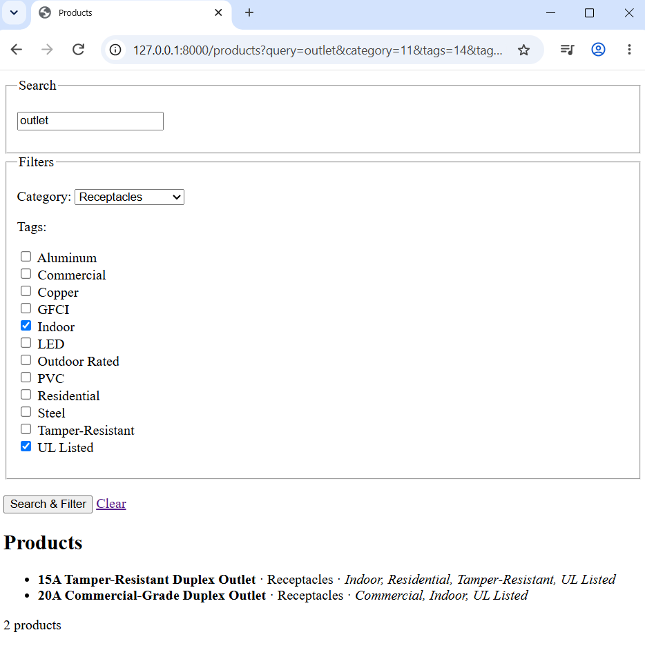

# django-product-catalog

A Django app for searching and filtering products by description, category, and tags.

## Getting Started

Requires Python 3.12+.

### Setup

From the project root:
```bash
python -m venv venv
source venv/bin/activate
pip install -r requirements.txt
python manage.py migrate
python manage.py loaddata sample_data
python manage.py createsuperuser  # optional, for admin access
```

The sample data, themed around electrical supplies, contains 6 categories, 12 tags, and 20 products.

### Run

With the virtual environment active:

```bash
python manage.py runserver
```
- Products page: http://127.0.0.1:8000/products
- Admin page: http://127.0.0.1:8000/admin

### Test
```bash
python manage.py test
```

## Assumptions

- A product must have exactly one category.
- A product can have zero or more tags.
- A product matches a search when its description contains the query as a substring (case-insensitive).
- A product matches a tag filter when it has *every* selected tag.
- If a category or tag is invalid, all search and filters are ignored and every product is shown.

## AI Attribution

I used Claude to generate parts of the code. I reviewed the AI-generated code before using it and adapted it where needed:

- **[models.py](catalog/models.py):** generated a draft, which I revised (e.g., removed the `name` field, made `description` unique).
- **[views.py](catalog/views.py):** suggested the `select_related(...).prefetch_related(...)` optimization.
- **[products.html](catalog/templates/catalog/products.html):** generated parts (submit/Clear, tags formatting), which I adapted into my own page structure.
- **[tests.py](catalog/tests.py):** generated a helper method (`get_products`), which the tests I wrote use.
- **Sample data:** generated the categories, tags, and products, which I entered manually through the Django admin and exported with `dumpdata`.

## Example

